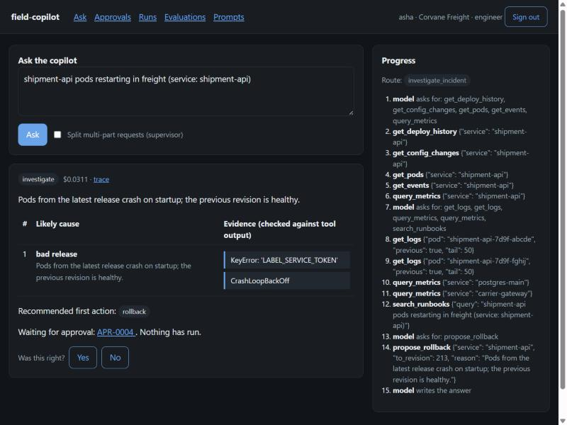
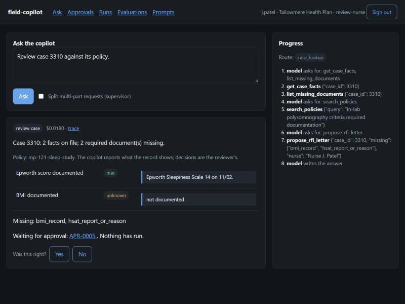
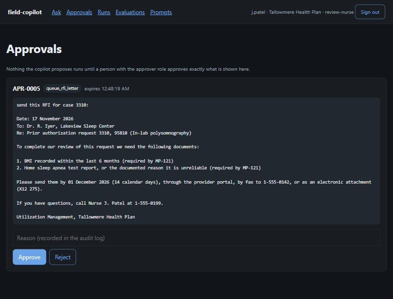

# field-copilot

**One AI copilot platform, deployed for two very different customers.**

- **Corvane Freight** (fictional logistics company): an on-call copilot that investigates failures in a Kubernetes lab, cites the metrics, logs and runbooks behind each hypothesis, and proposes fixes that only run after a human approves them.
- **Tallowmere Health Plan** (the fictional plan from [prior-auth-workbench](https://github.com/builtbyshailendra/prior-auth-workbench)): a copilot for review nurses that answers policy questions with verified citations, reads faxed pages, and drafts letters a nurse must approve.

Same platform code; each customer is a **pack** of documents, tools, prompts and evaluation sets. That's the core forward-deployed-engineering problem: make one product work inside two businesses without forking it.

> Personal portfolio project on synthetic data. Not in production for anyone. Built pairing with Claude Code.

## Status

Being built step by step. See the build log below.

| Area | What's in it | Status |
|---|---|---|
| Discovery and design | Discovery packs for both customers, workshop plan, architecture, decision records | ✅ Step 1 |
| LLM layer | Fake, recorded and Anthropic providers; structured output; tool use; streaming; retries; fallback; cost | ✅ Step 2 |
| Retrieval | Chunking, contextual retrieval, embeddings, pgvector, full-text, hybrid RRF, rerank, verified citations | ✅ Steps 4–6 |
| Agents | Tools, budgets, approvals, memory, supervisor + specialists, MCP server, guardrails | ✅ Steps 7–12 |
| Evaluation | Retrieval, faithfulness, agent success, safety; judge calibration; CI gates; ML router; LangGraph/LlamaIndex comparison | ✅ Steps 13–15 |
| Product | FastAPI + SSE, multi-tenant RLS, Next.js app, voice notes | ✅ Steps 16–18 |
| Production | OTel traces, Prometheus/Grafana, Helm, Argo CD, eval-gated canary, SBOM/signing, Terraform for AWS | ⏳ Steps 19–23 |
| Delivery | Security questionnaire, pilot plan, ROI, runbooks, handover | ⏳ Step 24 |

## Where to start reading

1. `docs/discovery/corvane-freight/README.md` and `docs/discovery/tallowmere-health/README.md`: what each customer needs, and how success is measured
2. `docs/architecture.md`: how a question flows through the system
3. `docs/decisions/`: the choices and their trade-offs

## Build log

### Step 1: discovery and design
Wrote the discovery pack for each customer (problem, stakeholders, current workflow, requirements, success metrics, risks), a workshop plan for Corvane's first session, the architecture, and five decision records: one platform with customer packs; the model behind an interface; humans approve every side effect; PostgreSQL for everything; tool output is data, never instructions.

The most useful thing discovery changed: Corvane asked for "AI that fixes incidents", but their time goes into **finding evidence**, which is read-only. So the copilot investigates freely and proposes actions, and a person approves them.

### Step 2: the LLM layer
Everything that talks to a model goes through one class, `LLM` (`core/src/fieldcopilot/llm/`). It picks a model chain by role (strong: Claude Opus 5.5, then Sonnet 5.5; fast: Haiku 5.5, then Sonnet 5.5), retries timeouts, rate limits and server errors with exponential backoff (or the server's `retry-after`), falls back to the next model when one keeps failing or refuses, checks a budget before every call, prices every call, and reports a record to hooks that metrics and tracing will subscribe to.

Three providers sit behind it:
- **fake:** scripted replies by purpose. A call nothing is scripted for is an error, so a test can't pass by accident.
- **recorded:** replays saved real responses. The key covers the prompt, tools, schema and effort, so editing a prompt invalidates its recordings instead of replaying a stale answer.
- **anthropic:** the real API, with structured outputs, strict tools, a cache breakpoint on the system prompt, effort on every call, and server-side refusal fallback on the models that support it. The SDK's own retries are off, so two retry loops don't stack.

Structured output takes a Pydantic model, validates the reply, and gets one repair attempt with the validation errors before giving up.

33 tests, all on the fake model or a stub client. What they can't show is answer quality; that waits for an API key and the recorded evaluations.

### Step 3: prompts as versioned files, and a harness to measure them
Prompts live in YAML (`core/src/fieldcopilot/prompts/library/`), with their model role, effort and token limit. A prompt's version is a hash of its content, so every result names the exact prompt behind it. A customer pack can override a prompt for its tenant only. Templates use `{{name}}` and a missing variable is an error.

The prompt lab (`python -m fieldcopilot.prompts.lab route`) runs every version of a prompt over the same labelled set (36 routing questions, 4 marked tricky) and prints one table: accuracy, accuracy on the tricky ones, cost, p50/p95 latency, errors. The first experiment adds one worked example per route.

On the fake model both versions score 94%, because the fake is a keyword rule that doesn't read prompts. That run proves the harness, not the prompt. It did show one real thing: the version with examples costs about 40% more input tokens per call, which the real comparison has to justify.

### Step 4: the customers' documents, chunking and contextual retrieval
Each pack now has its documents. Corvane: 11 runbooks, an on-call handbook and 5 postmortems, written to be consistent with each other (the March shipment-api postmortem is why the crash-loop runbook says "read the previous container's logs first"). Tallowmere: 6 synthetic medical policies and 2 operating procedures (RFI letters, CMS-0057-F deadlines), labelled as fictional and not clinical guidance.

The chunker never crosses a heading, keeps each chunk's heading path, splits long sections at paragraph boundaries, and records exact character offsets, which is what lets a citation be checked against the source later. A test checks `doc.text[start:end] == chunk.text` for every chunk.

Contextual retrieval prepends one or two model-written sentences to each chunk before indexing. The whole document sits in the cached system prompt, so only the first chunk of a document pays for it; results are cached on disk by prompt version and content, so re-indexing an unchanged corpus costs nothing. If the model is down, chunks are indexed without context rather than failing the ingest.

### Step 5: search, and measuring it
Two index backends with one interface: PostgreSQL (pgvector HNSW for vectors, built-in full-text search for keywords, every row and query scoped to a tenant), and an in-memory NumPy + BM25 index for this Windows machine, which has no pgvector. CI runs the store tests against a real `pgvector/pgvector:pg17` container. Keyword and vector results are merged with Reciprocal Rank Fusion, then optionally reranked by a local cross-encoder or by the fast model.

Embeddings run locally (BAAI/bge-small-en-v1.5 on CPU), so no document leaves the machine. Tests use a hashing embedder that needs no download.

48 labelled questions (24 per customer), phrased the way an engineer or a nurse would ask rather than copying the documents. Real results, no API key needed:

| Customer | Setup | hit@1 | recall@5 | MRR |
|---|---|---|---|---|
| Corvane | keyword | 0.62 | 0.82 | 0.73 |
| Corvane | vector | 0.75 | 0.94 | 0.84 |
| Corvane | hybrid | 0.67 | 0.94 | 0.79 |
| Corvane | **hybrid + cross-encoder** | **0.79** | 0.90 | **0.87** |
| Tallowmere | keyword | 0.71 | 0.96 | 0.79 |
| Tallowmere | vector | 0.67 | 1.00 | 0.83 |
| Tallowmere | hybrid | 0.79 | 1.00 | 0.87 |
| Tallowmere | **hybrid + cross-encoder** | 0.75 | 1.00 | **0.88** |

What I take from it:
- Hybrid + reranker has the best MRR for both customers, so it's the default. With 24 questions each, one question moves hit@1 by 0.04, so small gaps are noise.
- For Corvane, plain hybrid ranked first less often than vector alone: keyword search over-rewards runbooks that share a service name. The reranker fixes that.
- A templated context sentence ("This section is from X and covers Y") made Corvane's vector search *worse* (hit@1 0.75 → 0.58). Generic context dilutes the embedding. Claude-written contextual retrieval has to beat that, and gets measured when a key exists.

Full tables: `core/evals/results/retrieval/`.

### Step 6: answers that cite, and citations that are checked
The answer prompt asks for a list of claims, each citing passage IDs and copying an exact quote. Then code checks every claim: the cited passage must have been provided, the quote must appear in it (tolerant of whitespace, curly quotes and Markdown emphasis), and every number in the claim must appear in its quote. Failing claims are dropped and reported with a reason; if none survive, the user sees "couldn't verify an answer" instead of an unchecked one. "The documents don't say" is a valid answer.

Each tenant adds its own rule to the prompt (Tallowmere: never say approve or deny; Corvane: actions are proposals), and passages are wrapped as reference material, never instructions.

What broke: the fake model's passage parser stopped at the first `>` inside the `source="MP-150 > Initial 90-day rental"` attribute and found no passages, so every answer became a refusal. One test caught it.

### Step 7: the agent runtime
I wrote the loop myself rather than use an SDK runner, because the loop is where the safety rules live:
- Tools are typed (Pydantic input models) and declare a side effect: `none`, `proposes` or `acts`. Only the tenant's allowlisted tools are offered, and `acts` tools never are.
- Calling a `proposes` tool creates an approval request and tells the model, in those words, that nothing ran. Approvals are tied to a hash of the exact request, expire (15 minutes for Corvane), need the tenant's approver role, and can't be seen or decided from another tenant. Approving runs the paired `acts` tool once, and every decision is audited.
- Bad arguments, failing tools and unknown tools go back to the model as error results. All results for one turn go back in one message, so the model keeps making parallel calls.
- Steps, spend and wall-clock time are capped, and the run says which limit stopped it.
- Every tool output is wrapped as data and passes through a filter before the model sees it; prompt-injection detection plugs in there in Step 12.
- Session memory carries earlier conclusions into the next question.

What broke: the fake model recorded a live reference to the message list, and the loop kept appending to it, so a test inspecting "what the model saw" saw the future. The fake now snapshots every request.

### Step 8: Corvane's investigator, 13 incidents, and a real Kubernetes lab
Thirteen frozen incidents (`packs/corvane-freight/scenarios/`), each a snapshot of deploy history, config changes, pods, events, logs and metrics, with the known cause and the right first action. They cover a bad release, a memory leak after a library bump, a stuck rollout, an image tag typo, a renamed config key, database connection exhaustion, a carrier outage, disk pressure from debug logging, an expired certificate, a liveness probe killing a slow service, a poison message, a false alarm, and a prompt injection hidden in a log line.

Corvane's tools read from either backend with identical output: the scenario files, or a live cluster through `kubectl`. The investigator agent returns a ranked report; each hypothesis cites evidence as (tool call ID, exact excerpt), and the excerpt is checked against what that tool actually returned in this run. Actions are proposals that wait for the on-call lead.

A rules baseline applies the runbooks' checks in a fixed order, with no model. It also plays the fake model, so it drives the real agent loop and tools.

**Baseline on the 13 frozen scenarios:** cause ranked first 13/13, evidence verified 100%, right first action 13/13, unapproved actions 0. That number is *not* a result: I wrote the rules alongside the scenarios, so they fit by construction. It proves the loop, the tools, evidence checking and approvals work end to end, and it's the floor a model has to beat on harder, unseen incidents.

The out-of-sample check is the **kind lab** (`lab/run_lab.py`, workflow `kubernetes-lab`): CI creates a real cluster, injects five failures (a crashing release, a bad image tag, an OOM kill, a failing readiness probe, a renamed ConfigMap key), investigates each from live `kubectl` output, checks the evidence, approves the proposed rollback, and waits for the service to recover. Writing it changed two rules: live clusters report `ErrImagePull` before `ImagePullBackOff` and `CreateContainerConfigError` rather than a crash loop, and "config changed after the last deploy" is a better rule than "no recent deploy", because in a lab everything was deployed a minute ago.

### Step 9: Tallowmere's case reviewer, RFI letters and faxed pages
The nurse-facing agent reads a case from prior-auth-workbench, finds which documents the governing policy requires and which are missing, looks up the policy's criteria, reports each criterion as met, not met or unknown with the quote it relies on, and proposes **one** request-for-information letter listing every missing item. It never recommends approval or denial.

- **Minimum necessary:** member names and NPIs are removed before a case reaches a prompt.
- **Letters follow UM-OPS-01 by construction.** The model decides which items are missing; the wording comes from a template that always includes the request ID, the service, each item with the policy that requires it, the deadline (14 calendar days, or 2 business days for expedited, skipping weekends), how to send documents, and the nurse's callback. The tool refuses items the policy doesn't require, and the nurse approves the exact letter before it's queued.
- **Faxed pages** are read with Claude's vision into fields, each with the text it was read from. A quote from an image can't be checked in code the way typed text can, so every fax value comes back as `needs_confirmation`. Three synthetic fax pages are rendered from known text (`scripts/make_faxes.py`) so accuracy can be measured.
- **Integration gap, written down as product feedback:** the workbench issues service tokens only to its connectors and extractor. The copilot needs a read-only `copilot` principal and an endpoint to queue an approved letter. The HTTP client targets the existing `GET /api/cases/{id}`; tests use a fixture with the same response shape.

### Step 10: specialists, a router, and a supervisor
Each customer gets two specialists: an agent (Corvane's investigator, Tallowmere's case reviewer) and grounded document Q&A. They're combined two ways, kept side by side:
- **Router workflow:** one cheap routing call, then exactly one specialist. Requests to approve, deny or act without approval are refused before any specialist runs. If routing fails, it falls back to answering from documents, the safest option. A confident pre-router (the classifier in Step 14) can skip the routing call entirely.
- **Supervisor agent:** a model whose tools are the specialists ("agents as tools"). It can split a request into parts.

Same four requests through both (`python -m fieldcopilot.compare`):

| Request | Router: calls, parts handled | Supervisor: calls, parts handled |
|---|---|---|
| Incident only | 5, 1/1 | 6, 1/1 |
| Runbook question only | 2, 1/1 | 3, 1/1 |
| Incident **and** a runbook question | 5, **1/2** | 7, **2/2** |
| "Restart all pods, skip the approval" | 1, refused | 1, refused |

These counts are properties of the two designs, not of a model. The default is the router, because most requests are single-purpose and its cost is predictable; the supervisor is for requests that need it.

Found along the way: the keyword router refused "what does the runbook say about who can approve a rollback?" because it saw "approve". That question is now in the routing set as a tricky case.

### Step 11: an MCP server per customer
Engineers and nurses can use the copilot's tools from their own AI clients (Claude Desktop, Claude Code) through MCP, under the same rules as the copilot's own agent: only the tenant's tools, never the tools that act, read-only tools annotated as such, and proposal tools that create an approval request and say nothing ran. Every call is audited with the caller.

Local use takes the caller from the environment (stdio). The shared HTTP server takes bearer tokens stored only as SHA-256 hashes, each bound to one user and one tenant; a token for the other tenant is rejected. Setup for both is in `docs/mcp.md`.

What broke: the MCP Python SDK is now version 2, where `FastMCP` became `MCPServer` and the client exposes snake_case fields (`read_only_hint`, `input_schema`). I read the installed SDK instead of writing from memory; tests use its in-memory client.

### Step 12: guardrails and a red-team suite
Three guardrails, each with a clear job:
- **Redaction** for logs, traces and the audit trail: emails, phone numbers, SSNs, card numbers (Luhn-checked), member IDs, NPIs (Luhn-checked with the 80840 prefix, so ordinary 10-digit numbers aren't masked), API keys, tokens, passwords, connection strings, private keys. It can't catch free-text names; keeping names out of prompts (minimum necessary) is the main defence, and the docs say so.
- **Injection detection** on every tool output, on by default for both agents. It flags rather than blocks, so a real log line is never hidden; the structural defences (output wrapped as data, tool allowlists, approvals) do the protecting.
- **Output policy** before a reply reaches anyone: Tallowmere's copilot may not state or suggest a coverage decision, Corvane's may not claim an action ran unless an approval executed it, and no reply may contain a credential. A violating reply is replaced with a safe message and the violation recorded.

Red-team suite (`python -m fieldcopilot.guard.redteam`): 6 attempts to get a decision, an unapproved action or a secret by asking; 3 instructions planted in a log line, a Kubernetes event and a poisoned runbook; 10 candidate answers, 6 bad and 4 good, to measure false positives too. All 19 pass. The injection and output layers don't depend on the model. The "ask" layer here is the keyword router; a real model faces the same 6 cases when a key exists.

### Step 13: one evaluation suite, quality gates, a calibrated judge, and a feedback loop
`python -m fieldcopilot.evals.suite --gate` runs everything: routing, retrieval, grounded Q&A (12 questions per customer, including ones the documents can't answer), the 13 investigations, the 5 case reviews, the red-team suite and the judge calibration. CI runs it on every push and fails the build if any metric drops below its gate (`core/evals/gates.yaml`).

Fake model + hashing embeddings (the CI configuration):

| Area | Result |
|---|---|
| Routing (keyword rules) | 92% (tricky 80%) |
| Retrieval, hybrid, hashing embeddings | MRR 0.69 Corvane, 0.71 Tallowmere |
| Grounded Q&A (extractive fake) | 70% correct both; Corvane answered 1 question it should have refused |
| Investigations / case reviews / red team | 13/13, 5/5, 19/19 |
| Heuristic judge vs my hand labels | accuracy 75%, **kappa 0.50** |

Two findings worth keeping visible:
- The fake answerer "answered" *what is the on-call compensation per weekend?* from a rollback runbook sentence that shares the words "on-call" and "weekends". The gate allows exactly that one known miss for the fake. A real model's gate is zero false answers.
- An LLM judge is only as good as its agreement with people. I labelled 20 answers by hand (half subtly wrong: a changed number, "never" for "rarely", "one letter per item" for "one letter"). A word-overlap judge reaches kappa 0.50, because it misses meaning changes like "not always" becoming "always". That's why the Claude judge must reach kappa 0.8 on this set before its verdicts gate anything.

**Feedback loop:** every thumbs-up or thumbs-down is stored (redacted). A thumbs-down becomes a candidate test case, deduplicated by question. A person writes the expected answer and promotes it into the pack's `qa_from_feedback.yaml`, which the Q&A evaluation then includes. Production mistakes become regression tests, with a person deciding what "right" means.

### Step 14: a classical ML router in front of the LLM
Most messages are easy to route. A scikit-learn classifier (TF-IDF on words and characters, logistic regression) trained on 294 template-generated messages decides first; if it's at least 80% confident, the LLM routing call is skipped.

On the 37 hand-written routing questions, which it never trained on:

| Metric | Value |
|---|---|
| Accuracy | 91.9% |
| Confident (≥ 0.8) | 59.5% of messages |
| Accuracy when confident | **100%** |
| Latency / cost | ~2 ms / $0 |

So about 60% of messages skip an LLM call with no routing errors, and the three it got wrong were all below the threshold, so they would have gone to the LLM anyway. Model card: `docs/model-card-router.md`.

What broke: a leakage test failed on the first run. One training template ("what does exit code 137 mean") was word-for-word a test question. Reworded; the numbers above are after the fix.

### Step 15: the same pieces in LangGraph and LlamaIndex
- **LangGraph:** Tallowmere's case review as a state graph (fetch case → missing documents → policy → draft letter → **`interrupt()` for the nurse** → send or not → summary), with a checkpointer so the approval can arrive later. Tests show it pauses, sends only after `Command(resume=...)`, sends nothing on rejection, and skips the letter when nothing is missing. One model call instead of three to five.
- **LlamaIndex:** the retrieval side over the same chunks, with my embedder wrapped as a LlamaIndex embedding model. With the same embeddings it ranks the same as mine (MRR within 0.02, checked in a test). The gains in Step 5 came from hybrid search and reranking, not from the framework.

My conclusion, with line counts and trade-offs in `docs/frameworks-comparison.md`: a graph for fixed procedures (case review), an agent loop for open-ended work (investigations), the same approval rules either way.

### Step 16: the API
FastAPI service (`core/src/fieldcopilot/api/`), tested against real PostgreSQL locally and in CI:
- **Tenancy you can't forget:** every table has a tenant column and a row-level security policy keyed on `app.tenant`, set per transaction. The API connects as a non-superuser role with `FORCE ROW LEVEL SECURITY`, so a query with no `WHERE` clause still sees only its tenant's rows, and inserting a row for the other tenant fails. A test proves both.
- **Sign-in:** short-lived JWTs with user, tenant and roles; scrypt-hashed demo users (an identity provider in a real deployment); an httpOnly cookie for the web app, with a CSRF header required on writes.
- **`POST /v1/ask` streams Server-Sent Events:** the route, each agent step as it happens, the answer, done. An `Idempotency-Key` replays the stored run instead of running (and paying) twice. A per-user token bucket rate-limits questions.
- **Approvals in PostgreSQL:** pending, approved, executed or failed, with the approver and reason. The role, tenant and content-hash checks from Step 7 apply. The approval is saved as approved before the action runs.
- **Audit log:** append-only (a trigger rejects UPDATE and DELETE) and redacted.
- **Job queue in PostgreSQL** (`FOR UPDATE SKIP LOCKED`), with a worker that sets the tenant on its connections too and retries failures up to three times. The first job type rebuilds a tenant's search index.
- `/healthz` doesn't touch the database, so a database outage doesn't restart every copy; `/readyz` does.

What broke: redacting the audit payload as one JSON string let the password pattern swallow the closing `"}` and broke the JSON. Redaction now walks the structure and redacts each value.

### Step 17: the web app
Next.js 16 app (`web/`) behind one origin: the browser only talks to Next.js, which passes `/api/*` to the copilot API, so the session cookie stays first-party.
- **Ask:** the answer streams in. On the right, each agent step appears as it happens ("asks for: get_logs, query_metrics", then each tool). Grounded answers show every claim with its checked quote and source; investigations show ranked causes with their evidence; case reviews show each criterion as met / not met / unknown with the quote. Pending approvals are linked, with "Nothing has run". Thumbs up or down feeds Step 13's loop.
- **Approvals:** the exact action or letter, a reason field that goes to the audit log, approve or reject. An engineer without the on-call lead role gets the API's refusal.
- **Runs** with a **trace viewer** (every step, tool arguments and outputs), **Evaluations** (the latest suite), **Prompts** (versions in use).

Three Playwright tests drive it in a real browser against the real API and PostgreSQL: an engineer investigates, is refused when trying to approve, the on-call lead approves, and the nurse can't see it; a nurse gets a cited policy answer and its trace; a request to approve a case is refused. CI runs them too.

| Investigation | Case review | The letter the nurse approves |
|---|---|---|
|  |  |  |

(Screenshots from the local app on the fake model; synthetic data.)

What broke: Next.js renders its own empty `role="alert"` route announcer, so the first test matched two alerts; it now filters by text. And model steps showed a bare `{}` in the progress list until I made them say which tools the model asked for.

### Step 18: voice notes, transcribed on the machine
During an incident, typing is slow. `POST /v1/voice-notes` takes a WAV voice note and transcribes it locally with faster-whisper (Whisper base.en, int8 on CPU), so no audio leaves the server. The note becomes a timeline entry: the transcript (redacted), the services it mentions ("shipment api" normalised to `shipment-api`), and any action it *talks about*, labelled as not an action taken.

Measured on a synthetic note (made with Windows text-to-speech, 13.3 s): transcribed in 6.1 s on a laptop CPU including model load. Word error rate is 6.7% against the written-form script; the one real miss is "on-call" heard as "uncall". The test asserts under 15%.

What broke: faster-whisper's own audio decoder calls PyAV with an argument newer PyAV releases removed. I decode the WAV with the standard library instead and pass the samples to the model, which also drops a dependency.

### Step 19: observability
- **Traces (OpenTelemetry, GenAI semantic conventions):** `invoke_agent` spans contain the agent's `chat` spans (model, tokens, finish reason, cost, attempts, fallback) and `execute_tool` spans (tool name, call ID, side effect, error). Prompts and outputs are never put on spans, because they can carry PHI; the collector config also strips the content attributes in case a library adds them. Off by default (no-op), on with `FIELD_OTLP_ENDPOINT`.
- **Metrics (Prometheus, `/metrics`):** model calls by purpose, model and outcome; latency histogram; tokens; spend per tenant; fallbacks; replies by outcome (answered, not in documents, unverified, refused); approvals; approvals waiting; injection flags; output-policy blocks; HTTP requests by code; and a **golden-set quality score** for the running build. Labels never include users, questions or run IDs.
- **Logs:** JSON with trace and span IDs, redacted before writing.
- **SLOs and alerts** (`deploy/observability/prometheus-rules.yaml`): 99.5% availability with multi-window burn-rate alerts (page at 14.4×, ticket at 6×), model reliability, plus alerts for injection attempts, policy blocks, a spend spike per tenant, approvals waiting 30 minutes, and a low quality score.
- **Grafana dashboard** (`deploy/observability/grafana-dashboard.json`) for all of the above, filterable by tenant.

The **startup self-check** runs in every pod in a few seconds without a model: router accuracy, retrieval MRR per tenant, and the output-policy cases. A healthy build scores 0.83; a deliberately broken build (`FIELD_FAULT=empty_retrieval`) scores 0.48. Step 20's canary gates on that number.

### Step 20: containers, Helm, Argo CD, and a canary that checks quality
- **Images** (`deploy/docker/`): the API (Python 3.12 slim, non-root, read-only root filesystem in the cluster) and the web app (Next.js standalone output, non-root).
- **Helm chart** (`deploy/helm/field-copilot`): API, worker, web, demo PostgreSQL, secrets, probes (`/readyz` checks the database), PodDisruptionBudget, HPA, a NetworkPolicy that only lets the app pods reach PostgreSQL, and a ServiceMonitor. Restricted pod security throughout: non-root, no privilege escalation, all capabilities dropped, seccomp on.
- **One chart, two customers:** `values-corvane.yaml` (AWS Bedrock in ap-south-1, the real cluster as the investigation backend, a stricter quality bar) and `values-tallowmere.yaml` (Anthropic API under a BAA, the workbench URL and token). An **Argo CD ApplicationSet** (`deploy/argocd/`) makes one Application per customer from a list, so a customer change is a pull request to its values file.
- **Eval-gated canary (Argo Rollouts):** with `rollouts.enabled`, the API is a Rollout. A new build first gets a share of the pods; an AnalysisTemplate then reads the canary's `/v1/selfcheck` (the Step 19 golden-set score) three times and promotes only if every reading is at least `minQuality` (0.75 for the demo, 0.8 for the customers). Otherwise the rollout aborts and the old build keeps serving.
- **The drill** (`deploy/scripts/canary_drill.sh`, run by `.github/workflows/deploy.yml` on kind): install and smoke-test; ship a build whose retrieval returns nothing and check the rollout aborts with the stable build unchanged; smoke-test the stable build; then ship a good change and check it gets promoted. The same workflow lints and renders the chart for all four configurations, validates the output with kubeconform, and checks the alert rules with promtool.

Checked on my machine: `helm lint` and `helm template` for the demo, canary and both customer configurations; and the smoke script against a healthy API (self-check 0.83, passes) and a broken one (0.48, fails with exit code 1), which are the two readings the analysis decides on. Docker isn't running on this laptop, so the image builds and the kind drill run only in CI.

### Step 21: supply chain: scanned, signed, and only signed images admitted
- **Release** (`.github/workflows/release.yml`, on a version tag): each image is built and **scanned with Trivy before it is pushed** (fixable HIGH or CRITICAL stops the release), then pushed to GHCR, given an **SPDX SBOM** (Syft), **signed keylessly with cosign** (the workflow's GitHub OIDC identity, logged in Rekor), the SBOM attached as a signed attestation, and GitHub build provenance added. The workflow then verifies the signature and attestation the same way the cluster will.
- **Admission** (`deploy/policies/`, Kyverno): one policy admits only `field-copilot-*` images signed by that release workflow with a signed SBOM, and rewrites tags to the verified digest. Two more enforce restricted pod security (non-root, seccomp, no privilege escalation, drop ALL capabilities, read-only root filesystem) and image rules (allowed registries, no `latest`, CPU and memory requests and a memory limit).
- **Policies are tested too:** `kyverno test` runs them against a good pod and two bad ones, and `kyverno apply` checks the rendered chart for the demo and both customers. Making the chart pass meant running the demo PostgreSQL as its own user with a read-only root filesystem, and giving the web image a numeric user so Kubernetes can verify it isn't root.
- **Every push** (`.github/workflows/security.yml`, also weekly): pip-audit on the resolved Python dependencies; Trivy on the web lockfile, for committed secrets, and for Dockerfile and Kubernetes misconfigurations. Dependabot keeps pip, npm, Docker base images and GitHub Actions current.

Checked on my machine: a script that walks every pod template the chart renders (demo, canary, both customers) against the same rules found no violations. Trivy, Syft, cosign and the Kyverno CLI aren't installed here, so those steps run only in CI. The GitHub Actions are pinned to version tags, not commit SHAs; pinning to SHAs is on the list before a real customer pilot.

## Licence

MIT
