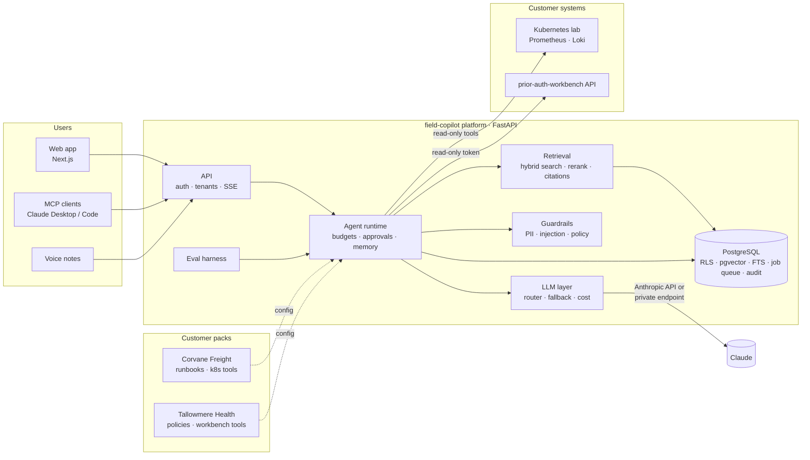

# Architecture

One platform, many customers. The platform knows how to talk to models, retrieve documents, run tools under budgets and approvals, check its own answers, and report what it did. A customer **pack** tells it which documents, tools, prompts and evaluation sets to use.

## Request flow (one question)

1. **API** authenticates the user, resolves the tenant, and sets the tenant on the database session so row-level security applies.
2. **Guardrails** redact PII from what will be logged and check the question against the tenant's policy.
3. **Router** decides: a direct answer, retrieval only, or an agent investigation. A cheap classifier goes first; the LLM router is the fallback.
4. **Agent** runs a loop with a step limit, token budget and wall-clock limit. Tools are typed; read-only tools run freely; tools with side effects create an **approval request** instead of running.
5. **Retrieval** runs keyword and vector search in PostgreSQL, merges with Reciprocal Rank Fusion, reranks, and returns chunks with stable IDs.
6. **Answer** comes back as structured output: claims, each with citations. Citations are **checked in code** against the source text. Claims that fail the check are removed and reported.
7. Everything is traced (OpenTelemetry GenAI conventions), metered (tokens, cost, latency) and audited.

## Why these choices

The decisions and their trade-offs are in `docs/decisions/`. The short version:
- PostgreSQL does vectors, full-text search, the job queue, tenancy and the audit log. One database to run, back up and secure.
- The model is behind an interface with three implementations (fake, recorded, Anthropic), so the whole system is testable without a key and the model can be swapped or put behind a private endpoint.
- Humans approve every side effect. The agent can propose; it can't act alone.
